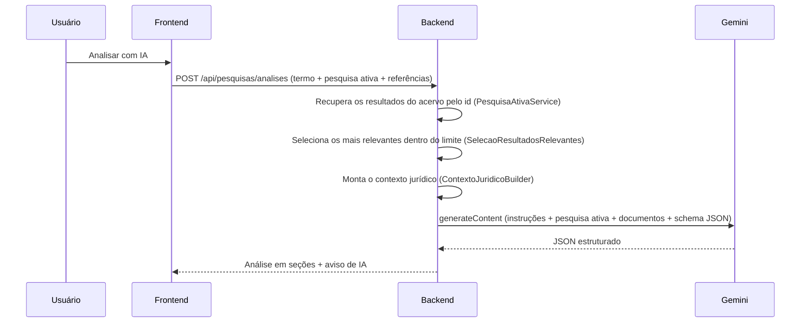

# Análise jurídica com IA (SCRUM-256)

Depois de uma pesquisa com resultados, o usuário pode pedir uma **análise jurídica gerada pelo Google Gemini**. A análise fica vinculada à **pesquisa ativa** (termo, filtros, ordenação e recorte dos gráficos): o backend recebe os resultados exibidos, escolhe os mais relevantes que cabem no limite da IA e a análise aparece num painel acima da lista.

## Como ligar

1. Crie uma chave no Google AI Studio: https://aistudio.google.com/apikey
2. No `.env` da raiz do projeto:

   ```env
   WIKILAW_GEMINI_ENABLED=true
   WIKILAW_GEMINI_API_KEY=sua-chave
   WIKILAW_GEMINI_MODEL=gemini-3.5-flash
   ```

3. Suba de novo o backend: `docker compose up -d --build backend`.

> A chave da API do Gemini é cobrada à parte das assinaturas do app Gemini (Google AI Pro/Ultra). O nível gratuito do AI Studio tem limite de requisições por minuto e por dia; quando o limite estoura, a tela mostra a mensagem de limite e o usuário pode tentar de novo.

Com `WIKILAW_GEMINI_ENABLED=false` (padrão), o botão continua visível, mas a geração responde **503** e a tela mostra a mensagem de indisponibilidade.

## Fluxo



- O navegador envia **apenas referências** (`categoria` e `id`). O texto dos documentos é lido do banco, então o usuário não consegue enviar outro conteúdo como se fosse acervo.
- Os documentos viram um **contexto jurídico** estruturado antes de ir ao modelo (ver abaixo).
- O Gemini responde no formato definido por um **schema JSON** (saída estruturada), e o backend valida e limita cada seção.
- As instruções do modelo mandam usar só os documentos enviados, citar a posição deles (`[1]`, `[2, 3]`) e tratar o conteúdo dos documentos como material de análise, não como instrução.
- O conteúdo enviado ao Gemini não é gravado em log.

## Contexto jurídico (SCRUM-263)

Os resultados da pesquisa ativa são o contexto da análise.

1. **Recuperação** (`PesquisaAtivaService`): o front envia a descrição da pesquisa (`pesquisa`) e até 200 referências na ordem exibida. O backend lê cada documento do acervo e recusa referências repetidas ou fora das categorias pesquisadas (400) e documentos que saíram do acervo (409).
2. **Seleção** (`SelecaoResultadosRelevantes`): na busca por similaridade ou na ordenação por relevância entram os primeiros. Com a lista ordenada por data, têm prioridade os resultados com mais palavras do termo (e da consulta montada a partir do documento anexado) no título, número, ementa, decisão ou palavras-chave; o empate fica com a posição.
3. **Contexto** (`ContextoJuridicoBuilder`): um `ContextoJuridico` com o termo, a descrição da pesquisa ativa (`DescricaoPesquisa`: tipo de busca, documento anexado, categorias, fontes, tribunal, período, recorte dos gráficos, ordenação e total) e um bloco por resultado, numerado pela **posição na lista** (`[1]`, `[5]`…) e ligado à `categoria` e ao `id` do acervo.
4. **Prompt** (`ContextoJuridicoPrompt`): a pesquisa vai em `<pesquisa_ativa>` e cada documento em `<documento numero="n">`; as instruções pedem que a análise respeite o recorte da pesquisa e registre em `limitacoes` quando os filtros limitarem a conclusão.

| Limite | Variável | Padrão |
| --- | --- | --- |
| Resultados enviados ao modelo | `WIKILAW_AI_CONTEXTO_MAX_DOCUMENTOS` | 10 |
| Caracteres do conteúdo, divididos igualmente entre os resultados | `WIKILAW_AI_CONTEXTO_MAX_CARACTERES` | 30.000 |
| Caracteres por campo (ementa, decisão etc.) | `WIKILAW_AI_CONTEXTO_MAX_CARACTERES_CAMPO` | 2.500 |

- Entram os resultados mais relevantes até o limite de documentos; os demais vão em `resultadosOmitidos`.
- Os dados de identificação (categoria, título, tribunal, órgão julgador, processo ou tema, relator, datas, situação e resultado) sempre entram. A ementa e depois a decisão ocupam o que sobrar da cota de cada resultado; um trecho que caberia com menos de 200 caracteres fica de fora.
- Quando algo é cortado ou omitido, o prompt avisa o modelo e a resposta traz `contextoResumido: true`.
- As instruções pedem que a análise se relacione ao caso pesquisado e considere as decisões e os precedentes encontrados.
- Sem resultados, o backend não chama a IA e responde **422** com "Não existem resultados suficientes para contextualizar a análise".

## Tokens

| Parte | Tamanho | Limite |
| --- | --- | --- |
| Entrada (instruções + até 10 documentos) | Cerca de 15 a 20 mil tokens no pior caso | ~1 milhão de tokens no `gemini-3.5-flash` |
| Raciocínio do modelo | Até 2.048 tokens (`WIKILAW_GEMINI_THINKING_BUDGET`) | Descontado do limite de saída |
| Análise (JSON) | Cerca de 1 a 2 mil tokens | Sobram ao menos 6.144 dos 8.192 de `WIKILAW_GEMINI_MAX_OUTPUT_TOKENS` |

Sem o teto de raciocínio, o modelo pode gastar o limite de saída pensando e cortar o JSON. Se isso ainda acontecer (`finishReason` `MAX_TOKENS`), a tela mostra a indisponibilidade e o usuário pode tentar de novo; aumente `WIKILAW_GEMINI_MAX_OUTPUT_TOKENS`. O backend recusa um teto de raciocínio maior ou igual ao limite de saída.

## Contrato

`POST /api/pesquisas/analises` (autenticado, com CSRF)

```json
{
  "termo": "dano moral negativação indevida",
  "pesquisa": {
    "modo": "textual",
    "consultaContextual": null,
    "documentoContexto": null,
    "categorias": ["decisoes", "precedentes"],
    "fontes": [],
    "tribunal": "STJ",
    "dataDe": "2024-01-01",
    "dataAte": null,
    "ordenacao": "mais-recentes",
    "resultadoDecisao": null,
    "orgaoJulgador": null,
    "totalResultados": 2
  },
  "resultados": [
    { "categoria": "decisoes", "id": 7 },
    { "categoria": "precedentes", "id": 3 }
  ]
}
```

| Campo | Regra |
| --- | --- |
| `termo` | Opcional, até 2.000 caracteres |
| `pesquisa` | Opcional; descreve a pesquisa ativa (todos os campos são opcionais) |
| `resultados` | Até 200 referências, sem repetição, na ordem exibida e dentro de `pesquisa.categorias`; só as mais relevantes que cabem no contexto vão ao modelo |

Resposta `200`:

```json
{
  "resumo": "Os documentos reconhecem o dano moral presumido [1, 2].",
  "questaoJuridica": "…",
  "entendimentoPredominante": "…",
  "pontosPrincipais": ["…"],
  "fundamentosLegais": ["CDC, art. 14"],
  "divergencias": [],
  "documentosRelevantes": [{ "categoria": "precedentes", "id": 3, "titulo": "Tema 1061", "motivo": "…" }],
  "limitacoes": ["…"],
  "geradaPorIa": true,
  "aviso": "Análise gerada com auxílio de inteligência artificial…",
  "modelo": "gemini-3.5-flash",
  "geradaEm": "2026-11-03T21:00:00-03:00",
  "documentosAnalisados": 2,
  "resultadosUtilizados": [{ "posicao": 1, "categoria": "decisoes", "id": 7 }, { "posicao": 2, "categoria": "precedentes", "id": 3 }],
  "resultadosOmitidos": [],
  "contextoResumido": false
}
```

`posicao` é a posição do resultado na lista exibida e o número das citações: `[2]` é o segundo resultado da pesquisa. A tela mostra essas posições e quantos resultados ficaram de fora.

| Status | Quando | O que a tela mostra |
| --- | --- | --- |
| `400` | Mais de 200 referências, repetidas ou fora das categorias da pesquisa | Pede para refazer a pesquisa |
| `422` | Nenhum resultado para contextualizar a análise | "Não existem resultados suficientes para contextualizar a análise" |
| `409` | Um documento saiu do acervo | Pede para refazer a pesquisa |
| `429` | Limite de uso do Gemini atingido | Mensagem de limite + "Tentar novamente" |
| `503` | IA desligada, sem chave, fora do ar, resposta bloqueada, cortada ou inválida | Mensagem de indisponibilidade + "Tentar novamente" |

## Critérios de aceite

| Critério | Implementação |
| --- | --- |
| CA01 — Geração | Botão **Analisar com IA** aparece depois de uma pesquisa com resultados; a análise é exibida no painel |
| CA02 — Apresentação estruturada | Seções fixas: resumo, questão jurídica e entendimento predominante em destaque, pontos principais, fundamentos legais, divergências, documentos mais relevantes (abrem o detalhe) e limitações |
| CA03 — Indisponibilidade | 429/503 viram mensagem de erro com botão **Tentar novamente** |
| CA04 — Identificação de IA | Selo "IA", aviso "Conteúdo gerado por inteligência artificial" e o modelo usado no rodapé; a API devolve `geradaPorIa`, `aviso` e `modelo` |

Uma nova pesquisa, ou outro filtro, ordenação ou recorte de gráfico, muda a pesquisa ativa e descarta a análise anterior.

## Código

| Camada | Arquivo |
| --- | --- |
| Cliente Gemini | `backend/.../integration/ai/GeminiClient.java`, `GeminiProperties.java` |
| Regra de negócio e instruções | `backend/.../service/AnaliseJuridicaService.java` |
| Pesquisa ativa | `backend/.../dto/PesquisaAtivaRequest.java`, `service/pesquisa/PesquisaAtivaService.java`, `SelecaoResultadosRelevantes.java` |
| Contexto jurídico | `backend/.../service/contexto/ContextoJuridicoBuilder.java`, `DescricaoPesquisa.java`, `ContextoJuridicoPrompt.java`, `integration/ai/ContextoJuridicoProperties.java` |
| Endpoint | `backend/.../controller/AnaliseJuridicaController.java` |
| Tela | `frontend/src/components/AnaliseIaPanel.tsx`, `frontend/src/analiseIa.ts` |
| Testes | `GeminiClientTest`, `AnaliseJuridicaServiceTest`, `AnaliseJuridicaControllerTest`, `ContextoJuridicoBuilderTest`, `ContextoJuridicoPromptTest`, `DescricaoPesquisaTest`, `PesquisaAtivaServiceTest`, `SelecaoResultadosRelevantesTest`, `frontend/tests/scrum-256-analise-ia.spec.ts`, `frontend/tests/scrum-263-analise-contextualizada.spec.ts` |

Para trocar de modelo (por exemplo, um Gemini mais novo ou o `gemini-pro-latest`). O `gemini-2.5-flash` não está mais disponível para contas novas, basta mudar `WIKILAW_GEMINI_MODEL`. Para trocar de provedor, implemente a interface `GenerativeAiProvider`.
