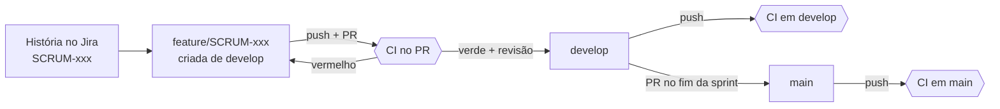
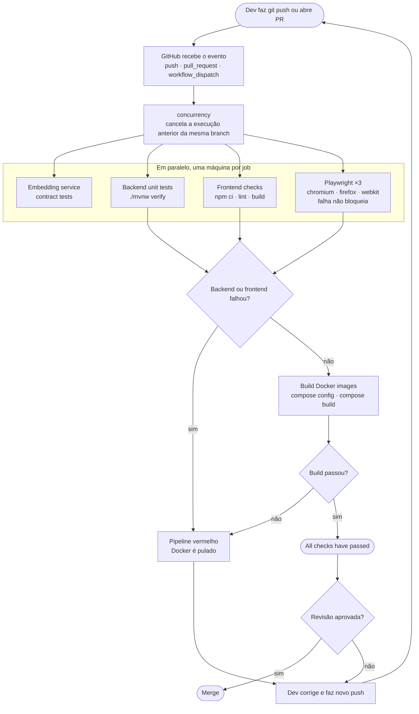
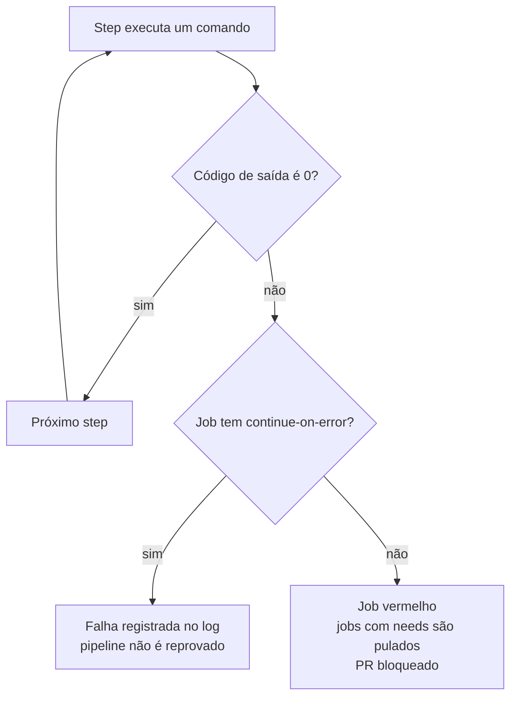

# Integração Contínua (CI) do WikiLaw

Documentação do pipeline de CI do projeto **WikiLaw** e do papel dele no processo DevOps e na metodologia Scrum da equipe.

> **Fonte:** `.github/workflows/ci.yml` · **Autor:** João Tuschtler · FATEC · atualizado em 04/11/2026

## Sumário

1. [Resumo](#1-resumo)
2. [Conceitos](#2-conceitos)
3. [O CI dentro da metodologia (Scrum)](#3-o-ci-dentro-da-metodologia-scrum)
4. [O pipeline em detalhe](#4-o-pipeline-em-detalhe)
5. [Como os testes funcionam](#5-como-os-testes-funcionam)
6. [Docker no CI](#6-docker-no-ci)
7. [Qualidade fora do CI: SonarQube](#7-qualidade-fora-do-ci-sonarqube)
8. [Limitações conhecidas e justificativas](#8-limitações-conhecidas-e-justificativas)
9. [Próximos passos: de CI para CD](#9-próximos-passos-de-ci-para-cd)
10. [Como manter o pipeline](#10-como-manter-o-pipeline)
11. [Glossário](#11-glossário)
12. [Perguntas frequentes](#12-perguntas-frequentes)

---

## 1. Resumo

O WikiLaw usa **GitHub Actions** para integração contínua. A cada push em `main` ou `develop`, e a cada pull request, um pipeline em máquinas Linux limpas testa o serviço de embeddings, compila e testa o backend e o frontend, testa a interface em três navegadores e, só depois disso, gera as imagens Docker.

Um PR só é aprovado com todos os checks verdes. Isso faz do CI parte da **Definition of Done** do Scrum: uma história do Jira (por exemplo, SCRUM-256) só está pronta quando o pipeline passa.

| Item | Valor no projeto |
| --- | --- |
| Ferramenta de CI | GitHub Actions (`.github/workflows/ci.yml`) |
| Gatilhos | push em `main`/`develop`, todo `pull_request`, execução manual (`workflow_dispatch`) |
| Máquina | Runners Linux hospedados pelo GitHub (`ubuntu-24.04`; `ubuntu-latest` no job de embeddings) |
| Jobs | 5 definidos; 7 checks no PR (o Playwright vira 3 pela matriz de navegadores) |
| Serviço de embeddings | Python 3.12 + pytest: testes de contrato sem baixar o modelo |
| Backend | Java 25 + Maven: `./mvnw --batch-mode verify` (75 classes de teste) |
| Frontend | Node 22: `npm ci`, `npm run lint`, `npm run build` |
| Interface | Playwright em Chromium, Firefox e WebKit (14 arquivos `.spec.ts`), na imagem oficial do Playwright |
| Empacotamento | `docker compose build backend frontend` |
| Qualidade estática | SonarQube, executado localmente (fora do CI) |
| Segredos | Nenhum: os testes simulam DataJud, Gemini e as demais APIs externas |

---

## 2. Conceitos

### 2.1 O que é CI

**Integração Contínua (Continuous Integration)** é a prática de integrar o código de todos os desenvolvedores num repositório compartilhado com frequência, várias vezes por dia ou a cada PR. Cada integração é validada automaticamente por um pipeline que compila, testa e verifica o código.

O objetivo é encontrar erros cedo, quando ainda são pequenos e baratos de corrigir, e evitar o "inferno da integração": semanas de trabalho isolado seguidas de um merge cheio de conflitos e regressões.

### 2.2 CI, Entrega Contínua e Implantação Contínua

| Prática | O que garante | Até onde vai | No WikiLaw |
| --- | --- | --- | --- |
| CI (Continuous Integration) | Todo código integrado é compilado e testado automaticamente | Build + testes + artefato | Implementado |
| CD: Continuous Delivery | Todo build aprovado está pronto para produção; a publicação é um clique (decisão humana) | Release versionada disponível | Não implementado |
| CD: Continuous Deployment | Todo build aprovado vai para produção sozinho, sem intervenção humana | Deploy automático | Não implementado |

O CI é a base do CD: não dá para entregar continuamente o que não é integrado e validado continuamente.

### 2.3 Onde o CI fica no ciclo DevOps

O ciclo DevOps costuma ser desenhado como um infinito: **Plan → Code → Build → Test → Release → Deploy → Operate → Monitor**, voltando ao Plan.

- **Plan**: backlog e sprints no Jira (histórias SCRUM-xxx).
- **Code, Build, Test**: cobertos pelo CI.
- **Release, Deploy**: cobertos pelo CD (próximo passo do projeto).
- **Operate, Monitor**: operação e observabilidade do sistema em produção.

### 2.4 Termos do processo

| Termo | Definição | No WikiLaw |
| --- | --- | --- |
| Compilar | Transformar código-fonte em código executável; o compilador aponta erros de sintaxe e de tipo | Java vira bytecode (`.class`); TypeScript vira JavaScript (`tsc`) |
| Build | Processo completo: baixar dependências, compilar, testar e empacotar | `./mvnw verify`, `npm run build`, `docker compose build` |
| Artefato | O resultado do build, o pacote pronto | `.jar`, pasta `dist/`, imagens Docker, relatório do Playwright |
| Release | Artefato validado, versionado (v1.2.0) e disponível para produção | Ainda não existe (seria uma tag + imagem publicada) |
| Deploy | Colocar uma release rodando num servidor | Fora do escopo atual |
| Pipeline | Sequência automatizada de etapas executada a cada mudança | O workflow `CI` |
| Job | Conjunto de etapas que roda numa máquina própria | `embedding-service-tests`, `backend-tests`, `frontend-checks`, `playwright-tests`, `docker-build` |
| Step | Um comando ou ação dentro de um job | `npm run lint`, `actions/checkout@v4` |
| Runner | Máquina que executa o job | Ubuntu hospedado pelo GitHub |
| Check | Resultado de um job exibido no PR (verde ou vermelho) | 7 checks no PR |

### 2.5 Princípios de CI e como o projeto atende

| Princípio | Como o WikiLaw aplica |
| --- | --- |
| Repositório único versionado | Monorepo no GitHub (`backend/`, `frontend/`, `embeddings/`, `docs/`), organização Forge-Fatec |
| Commits pequenos e frequentes | Uma branch por história (`feature/SCRUM-xxx`), Conventional Commits e PRs pequenos |
| Build automatizado | Maven, Vite e Docker disparados pelo workflow |
| Testes automatizados a cada integração | pytest no serviço de embeddings, JUnit no backend, ESLint/TypeScript/Playwright no frontend |
| Feedback rápido | Jobs em paralelo, cache de Maven e npm, imagem do Playwright com navegadores prontos, `cancel-in-progress` |
| Build quebrado tem prioridade | PR vermelho não é aprovado |
| Ambiente reproduzível | Runner limpo a cada execução; versões de Ubuntu, Java, Node, Python e Playwright fixadas |
| Visibilidade | Status no PR, logs por step, relatórios como artefatos |

---

## 3. O CI dentro da metodologia (Scrum)

O fluxo de trabalho liga cada história do Jira a uma branch e a um PR validado pelo CI:

1. A história é criada no Jira (por exemplo, SCRUM-256) e entra na sprint.
2. O desenvolvedor cria a branch `feature/SCRUM-256` a partir de `develop`.
3. Ele faz commits pequenos (Conventional Commits: `feat:`, `fix:`, `test:`, `docs:`, `ci:`) e envia com `git push`.
4. Ele abre um PR. O pipeline roda automaticamente.
5. Se algum check falhar, ele corrige e faz novo push; o pipeline roda de novo e a execução antiga é cancelada.
6. Com todos os checks verdes e revisão de código aprovada, o PR é mesclado em `develop`.
7. No fim da sprint, `develop` é mesclado em `main` por PR (a `main` não aceita push direto). O push em `main` roda o pipeline mais uma vez.

> **Definition of Done:** código revisado + todos os checks do CI verdes + critérios de aceite da história atendidos.



*Figura 1: fluxo de branches e os pontos onde o CI roda.*

---

## 4. O pipeline em detalhe

### 4.1 Visão geral



*Figura 2: fluxo geral do pipeline, do push ao merge.*

Os jobs de embeddings, backend, frontend e os três do Playwright rodam ao mesmo tempo, cada um na sua máquina. O tempo total é o do job mais lento somado ao build Docker, e não a soma de todos.

O job de embeddings não está no `needs` do build Docker: ele roda em paralelo e reprova o pipeline se falhar, mas não impede o build das imagens.

### 4.2 Configurações globais do workflow

```yaml
name: CI

on:
  push:
    branches: [main, develop]
  pull_request:
  workflow_dispatch:

permissions:
  contents: read

concurrency:
  group: ci-${{ github.workflow }}-${{ github.ref }}
  cancel-in-progress: true
```

| Configuração | O que faz | Por que existe |
| --- | --- | --- |
| `on: push` (main, develop) | Roda quando código chega às branches principais | Garante que as branches de integração estão sempre saudáveis |
| `on: pull_request` | Roda em todo PR aberto ou atualizado | Valida o código antes do merge |
| `workflow_dispatch` | Adiciona um botão "Run workflow" na aba Actions | Permite rodar manualmente, por exemplo para reexecutar sem novo commit |
| `permissions: contents: read` | O token do pipeline só pode ler o repositório | Princípio do menor privilégio: um passo comprometido não consegue alterar o código |
| `concurrency` + `cancel-in-progress` | Um novo push na mesma branch cancela a execução anterior | Economiza minutos de máquina e mostra só o resultado do código mais recente |

### 4.3 Job 1: Embedding service contract tests

```yaml
embedding-service-tests:
  name: Embedding service contract tests
  runs-on: ubuntu-latest
  timeout-minutes: 5
  steps:
    - uses: actions/checkout@v4
    - uses: actions/setup-python@v5
      with: { python-version: "3.12" }
    - run: pip install fastapi==0.157.0 pytest==9.1.1 httpx==0.28.1
    - working-directory: embeddings
      run: python -m pytest tests -q
```

- Testa o serviço interno de embeddings (`embeddings/app.py`, FastAPI), usado pela busca por similaridade local.
- Instala só as dependências leves de teste. O modelo de IA (`multilingual-e5-small`) **não é baixado**: os testes trocam o encoder por um `StubEncoder` que devolve vetores fixos.
- Verifica o contrato da API (`/health` e `/embed`, modos `query` e `passage`, 384 dimensões), os limites de entrada (lista vazia, texto em branco, textos grandes demais) e que o texto do documento não vaza na mensagem de erro.
- `timeout-minutes: 5`: é o job mais curto do pipeline.

### 4.4 Job 2: Backend unit tests

```yaml
backend-tests:
  name: Backend unit tests
  runs-on: ubuntu-24.04
  timeout-minutes: 15
  defaults:
    run:
      working-directory: backend
  steps:
    - uses: actions/checkout@v4
    - uses: actions/setup-java@v4
      with: { distribution: temurin, java-version: "25", cache: maven }
    - run: ./mvnw --batch-mode verify
```

- `actions/checkout@v4` baixa o código do commit que disparou o pipeline.
- `actions/setup-java@v4` instala o JDK 25 (distribuição Temurin) e restaura o cache das dependências Maven (`~/.m2`), o que deixa as próximas execuções mais rápidas.
- `./mvnw` é o Maven Wrapper: usa a versão do Maven definida no projeto, sem depender do que está instalado na máquina.
- `--batch-mode` deixa o Maven não interativo e com log limpo, próprio para CI.
- `verify` executa as fases do Maven em ordem: compilar, compilar os testes, rodar os testes (Surefire), empacotar o `.jar` e verificar.
- O **JaCoCo** acompanha os testes e gera o relatório de cobertura em `backend/target/site/jacoco/` (o mesmo que o SonarQube lê). No CI ele não tem limite mínimo e não é publicado como artefato.
- `timeout-minutes: 15` mata o job se ele travar, para não consumir horas de máquina.

### 4.5 Job 3: Frontend checks

```yaml
frontend-checks:
  name: Frontend checks
  runs-on: ubuntu-24.04
  timeout-minutes: 10
  steps:
    - uses: actions/checkout@v4
    - uses: actions/setup-node@v4
      with: { node-version: "22", cache: npm, cache-dependency-path: frontend/package-lock.json }
    - run: npm ci
    - run: npm run lint
    - run: npm run build
```

- `npm ci` faz uma instalação limpa e exata, seguindo o `package-lock.json`. Ao contrário do `npm install`, ele nunca altera o lock e falha se o lock estiver fora de sincronia com o `package.json`.
- `npm run lint` roda o ESLint (análise estática): encontra código fora do padrão, variáveis sem uso e uso incorreto de hooks do React, sem executar o código.
- `npm run build` roda `tsc -b && vite build`: o TypeScript checa todos os tipos e o Vite gera o bundle de produção em `dist/`.

### 4.6 Job 4: Playwright (matriz de navegadores)

```yaml
playwright-tests:
  name: Playwright (${{ matrix.browser }})
  runs-on: ubuntu-24.04
  container:
    image: mcr.microsoft.com/playwright:v1.62.1-noble
    options: --user 1001
  continue-on-error: true
  timeout-minutes: 15
  strategy:
    fail-fast: false
    matrix:
      browser: [chromium, firefox, webkit]
  steps:
    # ...checkout, setup-node, npm ci...
    - run: npm run test:e2e -- --project=${{ matrix.browser }}
    - name: Upload Playwright report
      if: ${{ !cancelled() }}
      uses: actions/upload-artifact@v4
      with:
        name: playwright-report-${{ matrix.browser }}
        path: frontend/playwright-report/
        retention-days: 7
```

- **`container`**: o job roda dentro da imagem oficial do Playwright, que já traz os três navegadores e as bibliotecas do sistema. Não há `playwright install` nem `apt-get`, então o job não depende de espelhos de pacotes e começa mais rápido. A tag da imagem (`v1.62.1`) precisa ser a mesma versão do `@playwright/test` no `frontend/package-lock.json`.
- **`--user 1001`**: roda como o mesmo usuário do runner, para os arquivos do checkout terem as permissões certas.
- **`strategy.matrix`**: o GitHub cria uma cópia do job para cada valor da lista. Por isso um único job definido aparece como **3 checks** no PR, um por navegador, rodando em paralelo.
- **`fail-fast: false`**: se um navegador falhar, os outros continuam até o fim. Assim dá para saber se o problema é de um navegador específico ou de todos.
- **`--project=<navegador>`**: roda só o projeto daquele navegador definido no `playwright.config.ts`.
- **`if: !cancelled()`**: o relatório é enviado mesmo quando os testes falham. É justamente nesse caso que ele é mais útil.
- **`upload-artifact`**: guarda o relatório HTML (com screenshots, vídeos e traces das falhas) por 7 dias, para download na página da execução.
- **`continue-on-error: true`**: uma falha no Playwright não deixa o pipeline vermelho nem bloqueia o build Docker. Ver a [seção 8](#8-limitações-conhecidas-e-justificativas).

### 4.7 Job 5: Build Docker images

```yaml
docker-build:
  name: Build Docker images
  runs-on: ubuntu-24.04
  timeout-minutes: 20
  needs: [backend-tests, frontend-checks, playwright-tests]
  env:
    POSTGRES_PASSWORD: ci-only-password
  steps:
    - uses: actions/checkout@v4
    - run: docker compose config --quiet
    - run: docker compose build backend frontend
```

- **`needs`** cria a dependência: o job só começa depois que os jobs listados terminam. Assim, imagem só é gerada a partir de código já testado.
- **`docker compose config --quiet`** valida a sintaxe e as variáveis do `docker-compose.yml` antes do build.
- **`POSTGRES_PASSWORD`**: o compose declara essa variável como obrigatória (`${POSTGRES_PASSWORD:?...}`). Sem ela, a validação falha. No CI é usada uma senha descartável, que não é a de produção. As chaves de API (DataJud, Gemini) são opcionais no compose e ficam vazias.
- **`docker compose build backend frontend`** gera as duas imagens a partir dos Dockerfiles. O pipeline não sobe os containers nem publica as imagens. A imagem do serviço de embeddings não é construída no CI.

### 4.8 Os 7 checks no PR

O nome de cada check segue o formato **Workflow / Job (evento)**, por exemplo `CI / Backend unit tests (pull_request)`. O GitHub lista os checks em ordem alfabética, não na ordem de execução.

| Check | Pergunta que responde | Falha significa |
| --- | --- | --- |
| Embedding service contract tests | O serviço de embeddings respeita o contrato e os limites? | Rota, formato da resposta ou validação de entrada quebrados |
| Backend unit tests | O backend compila e as regras de negócio funcionam? | Teste JUnit quebrado, erro de compilação, query inválida |
| Frontend checks | O frontend segue o padrão, tem tipos corretos e gera build? | Erro de lint, erro de tipo, build de produção quebrado |
| Playwright (chromium) | A interface funciona no Chrome/Edge? | Tela ou fluxo quebrado nesse navegador |
| Playwright (firefox) | A interface funciona no Firefox? | Idem, no Firefox |
| Playwright (webkit) | A interface funciona no Safari? | Idem, no motor do Safari |
| Build Docker images | A aplicação pode ser empacotada para entrega? | Dockerfile ou compose inválido, dependência que não instala |

### 4.9 O que acontece dentro de cada job

Cada coluna é um job, executado numa máquina própria. Os passos de uma coluna rodam em sequência; as colunas rodam ao mesmo tempo, menos o build Docker, que espera backend, frontend e Playwright.

```mermaid
flowchart TB
    subgraph E [Embedding service · Python 3.12]
        E1[Checkout] --> E2[Setup Python] --> E3[pip install<br/>fastapi · pytest · httpx] --> E4[pytest<br/>encoder simulado]
    end
    subgraph B [Backend · Java 25]
        B1[Checkout] --> B2[Setup Java<br/>cache Maven] --> B3[./mvnw verify<br/>compila · JUnit · .jar]
    end
    subgraph F [Frontend · Node 22]
        F1[Checkout] --> F2[Setup Node<br/>cache npm] --> F3[npm ci] --> F4[npm run lint] --> F5[npm run build<br/>tsc + vite]
    end
    subgraph P [Playwright ×3 · imagem oficial]
        P1[Checkout + Setup Node] --> P2[npm ci] --> P3["npm run test:e2e<br/>só o projeto do navegador"] --> P4[Upload do relatório<br/>mesmo com falha]
    end
    subgraph D [Docker · depois de B, F e P]
        D1[Checkout] --> D2[compose config] --> D3[compose build<br/>backend + frontend]
    end
```



*Figura 3: etapas internas de cada job do pipeline.*

### 4.10 Como o GitHub decide se o check fica verde ou vermelho

Todo comando devolve um código de saída: **0** significa sucesso; qualquer outro valor, falha. É esse número que define a cor do check.



*Figura 4: decisão de sucesso ou falha de um job.*

- Um step que falha faz os steps seguintes do mesmo job serem pulados, exceto os marcados com `if: ${{ !cancelled() }}`, como o upload do relatório do Playwright.
- Com `continue-on-error: true`, a falha do job fica registrada no log, mas não reprova o pipeline nem impede os jobs que dependem dele.
- Sem essa opção, o job fica vermelho, os jobs com `needs` apontando para ele são pulados e o PR fica bloqueado.

---

## 5. Como os testes funcionam

Os testes definem o que validar; o CI garante que essa validação rode sempre, a cada mudança, sem depender de alguém lembrar.

### 5.1 Pirâmide de testes

| Camada | O que testa | Velocidade | Quantidade ideal | No WikiLaw |
| --- | --- | --- | --- | --- |
| E2E | O sistema inteiro, como o usuário usa | Lenta | Poucos | Ainda não existe E2E com backend real |
| Interface | Telas no navegador com a API simulada | Média | Alguns | Playwright (14 specs) |
| Integração | Partes juntas: repositório + banco, rota + serviço | Segundos | Vários | `@DataJpaTest`, `@SpringBootTest` |
| Contrato | A API de um serviço responde no formato combinado | Segundos | Alguns | pytest do serviço de embeddings |
| Unitário | Uma classe isolada | Milissegundos | Muitos | JUnit puro no backend |

### 5.2 Backend: JUnit 5 + Spring Boot Test

Ferramentas: **JUnit 5** (estrutura dos testes), **AssertJ** (verificações legíveis), **Mockito** (dublês de dependências), **Spring Boot Test** (sobe o Spring dentro do teste) e **Maven Surefire** (encontra e executa as classes `*Test.java`).

#### Unitário puro

```java
class LegalTextNormalizerTest {
    private final LegalTextNormalizer normalizer = new LegalTextNormalizer();

    @Test
    void blankMarkupBecomesNull() {
        assertNull(normalizer.normalize("<div> &nbsp; </div>"));
    }
}
```

Sem Spring e sem banco: a classe é criada com `new` e o método é chamado direto. Exemplos: `LegalTextNormalizerTest`, `LegalTextChunkerTest`, `SearchTermProcessorTest`, `AnaliseJuridicaServiceTest`.

#### Integração com banco (`@DataJpaTest`)

```java
@DataJpaTest(showSql = false)
@AutoConfigureTestDatabase(replace = AutoConfigureTestDatabase.Replace.NONE)
class TribunalRepositoryTest {
    @Test
    void findsTribunalBySigla() {
        repository.saveAndFlush(tjsp);
        assertThat(repository.findBySigla("TJSP")).get()
            .extracting(Tribunal::getNome)
            .isEqualTo("Tribunal de Justiça de São Paulo");
    }
}
```

Sobe só a camada JPA ligada a um banco **H2 em memória**. Testa se as queries do repositório funcionam de verdade. Cada teste roda numa transação desfeita (rollback) no final, então um teste não interfere no outro. São 19 classes de teste de repositório na pasta `repository/`.

Os testes que precisam de PostgreSQL com pgvector (`VectorPostgresIntegrationTest`) ficam **pulados** no CI, porque o runner não tem esse banco.

#### Integração da aplicação (`@SpringBootTest` + `MockMvc`)

Testes como `SemanticSearchControllerTest` e `AnaliseJuridicaControllerTest` sobem a aplicação inteira e fazem requisições HTTP simuladas com `MockMvc`, validando status e o JSON de resposta. Rota, validação, controller e tratamento de erros são testados juntos, sem abrir uma porta de rede.

#### APIs externas sem dependência externa

Os clientes de APIs externas são testados contra um `HttpServer` falso em `127.0.0.1`:

- `DataJudClientTest` confere a requisição enviada (por exemplo, o cabeçalho `Authorization`) e a resposta tratada.
- `GeminiClientTest` e `GeminiEmbeddingClientTest` simulam o Gemini: resposta normal, limite de uso (HTTP 429), resposta bloqueada ou cortada, vetores com dimensão errada.

Por isso o CI **não precisa de nenhuma chave de API** e não consome a cota do Gemini.

#### Configuração de teste

Arquivo `backend/src/test/resources/application.properties`:

```properties
spring.datasource.url=jdbc:h2:mem:wikilaw;MODE=PostgreSQL;...
spring.jpa.hibernate.ddl-auto=create-drop
spring.flyway.enabled=false
wikilaw.import.worker.enabled=false
wikilaw.bootstrap.jurisprudencia.enabled=false
wikilaw.semantic.backfill.enabled=false
```

- H2 em memória no modo PostgreSQL: o CI não precisa de um banco instalado.
- `create-drop`: o schema é criado no início e apagado no fim.
- Flyway, workers de importação e bootstrap desligados: os testes ficam isolados, rápidos e sem chamadas externas.
- Embeddings e análise com IA ficam desligados por padrão (`WIKILAW_EMBEDDING_ENABLED` e `WIKILAW_GEMINI_ENABLED` valem `false`).

### 5.3 Frontend: análise estática, tipos e Playwright

| Camada | Ferramenta | Comando | Pega o quê |
| --- | --- | --- | --- |
| Análise estática | ESLint | `npm run lint` | Código fora do padrão, hooks usados errado |
| Checagem de tipos | TypeScript (`tsc -b`) | `npm run build` | Tipo errado passado para função ou componente |
| Build | Vite | `npm run build` | Import quebrado, bundle que não gera |
| Interface | Playwright | `npm run test:e2e` | Tela, filtro, paginação ou fluxo quebrado |

#### O que é o Playwright

Ferramenta open source da Microsoft que controla um navegador real por código: abre páginas, clica, digita e confere o que aparece na tela. No CI, roda em modo headless (sem janela visível).

#### Como os testes do WikiLaw usam o Playwright

```ts
await page.route('**/api/pesquisas/analises', (route) =>
  route.fulfill({ status: 503, json: { error: 'Análise por IA indisponível' } }))  // resposta falsa
await pesquisar(page, 'negativação indevida')
await page.getByRole('button', { name: 'Analisar com IA' }).click()
await expect(page.getByRole('alert')).toContainText('indisponível')
```

O `page.route` intercepta as chamadas à API e devolve um JSON definido pelo teste. **O backend não participa.** Por isso, o termo tecnicamente correto é "teste de interface com API simulada", e não "E2E completo".

- **Vantagens:** testes determinísticos (o mesmo dado sempre), rápidos e independentes do banco, capazes de simular casos difíceis como lista vazia, paginação ou a IA fora do ar.
- **Limitação:** não garantem o contrato real entre front e back. Se o backend renomear um campo do JSON, esses testes continuam passando.

#### Configuração do Playwright (`playwright.config.ts`)

| Opção | Valor | Motivo |
| --- | --- | --- |
| `webServer` | sobe o Vite antes dos testes | O teste não depende de alguém subir o servidor |
| `projects` | chromium, firefox, webkit | Compatibilidade entre navegadores |
| `retries` | 2 no CI, 0 local | Absorve instabilidade pontual de rede ou tempo |
| `workers` | 1 | Evita disputa de recursos na máquina |
| `forbidOnly` | ativo no CI | Um `test.only` esquecido pularia todos os outros testes |
| `reducedMotion` | `reduce` | Animações terminam na hora e não atrasam os testes |
| `screenshot` / `video` | só em falha | Evidência do erro sem pesar nas execuções verdes |
| `trace` | na primeira repetição | Linha do tempo da execução para depurar a falha |

---

## 6. Docker no CI

O job `docker-build` prova que o código testado pode ser empacotado. As imagens usam **multi-stage build**: uma etapa pesada compila, e a imagem final leva só o necessário para rodar.

| Imagem | Etapa de build | Imagem final | Expõe |
| --- | --- | --- | --- |
| Backend | `maven:3.9.16-eclipse-temurin-25`: `mvn clean package -DskipTests` | `eclipse-temurin:25-jre` + `app.jar` | 8080 |
| Frontend | `node:22`: `npm ci` + `npm run build` | `nginx:alpine` servindo `dist/` | 80 |

- **Por que `-DskipTests` no Dockerfile?** Os testes já rodaram no job do backend. Repetir no build da imagem só gastaria tempo.
- **Por que JRE e nginx na imagem final?** A imagem fica menor e com menos superfície de ataque: não leva compilador, Maven nem código-fonte.
- O `docker-compose.yml` orquestra PostgreSQL com pgvector, backend, frontend e o serviço de embeddings, além do SonarQube para análise local.

---

## 7. Qualidade fora do CI: SonarQube

O projeto tem um SonarQube configurado no `docker-compose.yml` (serviços `sonarqube`, `sonarqube-db` e `sonar-scanner`, perfil `analysis`) e o script `sonar-analysis.sh`. A análise roda **localmente**, não no GitHub Actions.

O SonarQube aponta bugs, vulnerabilidades, code smells, duplicação e cobertura. O próximo passo é levá-lo para o pipeline (SonarCloud) com um **quality gate**: o PR falha se a qualidade cair.

---

## 8. Limitações conhecidas e justificativas

| Ponto | Situação atual | Justificativa ou plano |
| --- | --- | --- |
| Playwright não bloqueia | `continue-on-error: true`: uma falha não deixa o pipeline vermelho | Testes em estabilização; tornar obrigatório quando estiverem confiáveis |
| Embeddings fora do `needs` | O build Docker não espera o job de embeddings | Incluir `embedding-service-tests` no `needs` do `docker-build` |
| `ubuntu-latest` no job de embeddings | Os outros jobs fixam `ubuntu-24.04` | Fixar `ubuntu-24.04` também, pelo mesmo motivo de reprodutibilidade |
| Nome do job do backend | "Backend unit tests" roda unitários e integração juntos | Renomear ou separar com Surefire (`*Test`) e Failsafe (`*IT`) |
| H2 no lugar do PostgreSQL | Testes usam H2 no modo PostgreSQL; os de pgvector são pulados | H2 não reproduz tudo (JSONB, pgvector); usar Testcontainers com PostgreSQL real |
| API simulada no Playwright | Interface testada sem backend | Adicionar poucos E2E reais com `docker compose up` e testes de contrato |
| IA sempre simulada | Nenhum teste chama o Gemini de verdade | Teste manual com chave real; um smoke test opcional com secret no GitHub |
| Sem testes unitários no front | Lógica do front testada só pela interface | Adicionar Vitest + Testing Library |
| Cobertura sem limite | O JaCoCo mede a cobertura do backend, mas o relatório não é publicado e não há mínimo exigido | Publicar o relatório como artefato, definir um mínimo e medir o front com Vitest |
| Sonar fora do CI | Análise só local | SonarCloud com quality gate no PR |
| Sem CD | Imagens são construídas, mas não publicadas | Publicar no GitHub Container Registry e fazer deploy em homologação |

---

## 9. Próximos passos: de CI para CD

1. **Proteção de branch** em `develop` (a `main` já exige PR): exigir os checks verdes e uma revisão para o merge.
2. **Playwright obrigatório**: remover `continue-on-error` quando os testes estiverem estáveis.
3. **Ajustes no workflow**: fixar `ubuntu-24.04` no job de embeddings e incluí-lo no `needs` do build Docker.
4. **Cobertura de testes**: publicar o relatório do JaCoCo, exigir um mínimo e ligar o quality gate do SonarCloud no PR.
5. **Segurança**: Dependabot para dependências e scan de vulnerabilidades nas imagens (por exemplo, Trivy).
6. **Release**: ao criar uma tag `v*`, publicar as imagens versionadas no GitHub Container Registry.
7. **Continuous Delivery**: deploy automático em homologação; produção com aprovação manual (GitHub Environments).
8. **Monitoramento**: health check (Spring Actuator) e logs centralizados, fechando o ciclo DevOps.

---

## 10. Como manter o pipeline

| Situação | O que fazer |
| --- | --- |
| Atualizou o `@playwright/test` | Trocar a tag da imagem `mcr.microsoft.com/playwright:vX.Y.Z-noble` para a mesma versão |
| Mudou a versão do Java ou do Node | Atualizar `java-version`/`node-version` no `ci.yml` **e** a imagem base no `Dockerfile` correspondente |
| Nova variável obrigatória no compose (`${VAR:?...}`) | Adicionar um valor descartável em `env` do job `docker-build` |
| Novo teste que chama API externa | Simular a API (`HttpServer` falso no backend, `page.route` no Playwright); o CI não tem chaves |
| Check do Playwright verde, mas com dúvida | Abrir o log do job ou baixar o artefato `playwright-report-<navegador>` |
| Rodar o pipeline sem novo commit | Aba **Actions** → **CI** → **Run workflow** |

Para reproduzir o CI na máquina antes do push:

```bash
cd embeddings && python -m pytest tests -q
cd backend && ./mvnw --batch-mode verify
cd frontend && npm ci && npm run lint && npm run build
cd frontend && npm run test:e2e -- --project=chromium
POSTGRES_PASSWORD=ci-only-password docker compose config --quiet
```

---

## 11. Glossário

| Termo | Significado |
| --- | --- |
| GitHub Actions | Serviço de CI/CD integrado ao GitHub; lê os workflows em `.github/workflows/` |
| Workflow | Arquivo YAML que define o pipeline (`ci.yml`) |
| Action | Passo reutilizável publicado por terceiros, por exemplo `actions/checkout@v4` |
| Matrix | Gera várias cópias de um job, uma por valor (aqui, uma por navegador) |
| Container job | Job que roda dentro de uma imagem Docker em vez de direto no runner |
| Artifact | Arquivo salvo pela execução para download posterior |
| Cache | Dependências reaproveitadas entre execuções para acelerar o pipeline |
| Headless | Navegador rodando sem interface gráfica |
| Mock / Stub | Substituto controlado de uma dependência real (API, banco, modelo de IA) |
| Teste de contrato | Verifica se uma API responde no formato combinado com quem a consome |
| Flaky test | Teste que às vezes passa e às vezes falha sem mudança no código |
| Quality gate | Regra que reprova o build se a qualidade ficar abaixo de um limite |
| Shift-left | Mover testes e verificações para o início do processo, quando corrigir é mais barato |

---

## 12. Perguntas frequentes

<details>
<summary><b>1. O que é CI, em uma frase?</b></summary>

É integrar o código de todos com frequência e validar cada integração automaticamente, com build e testes, para encontrar erros cedo.
</details>

<details>
<summary><b>2. Qual a diferença entre CI e CD?</b></summary>

O CI garante que o código integrado compila e passa nos testes. O CD continua a partir daí: Continuous Delivery deixa toda versão aprovada pronta para produção com um clique; Continuous Deployment publica automaticamente, sem intervenção humana. O WikiLaw tem CI; o CD é o próximo passo.
</details>

<details>
<summary><b>3. Por que usar CI? Qual problema resolve?</b></summary>

Evita o "inferno da integração". Sem CI, ninguém garante que o merge de três pessoas não quebrou o sistema, e o erro só aparece tarde, quando é mais caro de corrigir. Com CI, o erro aparece minutos depois do push, no próprio PR.
</details>

<details>
<summary><b>4. O que dispara o pipeline?</b></summary>

Push em `main` ou `develop`, qualquer pull request e a execução manual pelo botão "Run workflow" (`workflow_dispatch`).
</details>

<details>
<summary><b>5. Onde o pipeline roda?</b></summary>

Em máquinas virtuais Ubuntu criadas pelo GitHub para cada job e descartadas no fim. O job do Playwright roda ainda dentro de um container com a imagem oficial do Playwright. Isso garante um ambiente limpo e reproduzível, que não depende da máquina de nenhum desenvolvedor.
</details>

<details>
<summary><b>6. Por que o PR mostra 7 checks se o workflow tem 5 jobs?</b></summary>

Porque o job do Playwright usa `strategy.matrix` com três navegadores. O GitHub cria uma cópia do job para cada um: chromium, firefox e webkit. São 4 jobs comuns + 3 cópias do Playwright.
</details>

<details>
<summary><b>7. Por que separar em vários jobs em vez de um só?</b></summary>

Para rodar em paralelo (feedback mais rápido) e isolar a falha: o check vermelho já mostra se o problema é do serviço de embeddings, do backend, do frontend, de um navegador específico ou do empacotamento.
</details>

<details>
<summary><b>8. Como funciona a ordem dos jobs?</b></summary>

Embeddings, backend, frontend e os três Playwright rodam em paralelo. O `docker-build` tem `needs` e só começa depois que backend, frontend e Playwright terminam.
</details>

<details>
<summary><b>9. O que acontece se um teste falhar?</b></summary>

O comando devolve um código de saída diferente de zero, o step falha, o job fica vermelho e o PR mostra o check com erro. Pela Definition of Done, o PR não é mesclado até ser corrigido.
</details>

<details>
<summary><b>10. O Playwright verde significa que todos os testes passaram?</b></summary>

Não necessariamente. O job tem `continue-on-error: true`, então uma falha nele não derruba o pipeline. É uma escolha temporária enquanto os testes estabilizam. Para confirmar, é preciso abrir o log ou o relatório do job.
</details>

<details>
<summary><b>11. Qual a diferença entre teste unitário e de integração?</b></summary>

O unitário testa uma classe isolada, sem banco nem rede, em milissegundos (por exemplo, `LegalTextNormalizerTest`). O de integração testa peças juntas, como o repositório gravando e consultando o banco (`TribunalRepositoryTest`, com `@DataJpaTest`).
</details>

<details>
<summary><b>12. Que banco os testes do backend usam?</b></summary>

H2 em memória, no modo de compatibilidade com PostgreSQL. Assim o CI não precisa de um banco instalado. A limitação é que o H2 não reproduz tudo do PostgreSQL (os testes de pgvector são pulados); a evolução é o Testcontainers.
</details>

<details>
<summary><b>13. Os testes do Playwright testam o backend?</b></summary>

Não. Eles interceptam as chamadas à API com `page.route` e devolvem respostas falsas. São testes de interface com API simulada: determinísticos e rápidos, mas não validam o contrato real entre front e back.
</details>

<details>
<summary><b>14. O CI usa a chave do Gemini ou de outras APIs?</b></summary>

Não. Os clientes do Gemini, do DataJud e das demais fontes são testados contra servidores falsos, e o Playwright simula as rotas do backend. O pipeline não tem segredos configurados e não consome a cota de nenhuma API.
</details>

<details>
<summary><b>15. O que o <code>npm run build</code> valida?</b></summary>

Roda o compilador do TypeScript (`tsc -b`), que checa todos os tipos, e depois o Vite, que gera o bundle de produção. Se um tipo estiver errado ou um import quebrado, o build falha.
</details>

<details>
<summary><b>16. Qual a diferença entre <code>npm ci</code> e <code>npm install</code>?</b></summary>

O `npm ci` instala exatamente o que está no `package-lock.json`, apaga o `node_modules` antes e falha se o lock estiver fora de sincronia. É reproduzível, ideal para CI. O `npm install` pode atualizar o lock.
</details>

<details>
<summary><b>17. Para que serve o cache no pipeline?</b></summary>

Reaproveita as dependências do Maven e do npm entre execuções. Evita baixar tudo de novo e reduz o tempo do pipeline.
</details>

<details>
<summary><b>18. Por que o Playwright roda dentro de um container?</b></summary>

A imagem oficial já traz os navegadores e as bibliotecas do sistema. Sem ela, cada execução precisaria rodar `playwright install --with-deps`, que baixa centenas de MB e depende dos espelhos do `apt`, deixando o job mais lento e sujeito a falhas que não têm a ver com o código.
</details>

<details>
<summary><b>19. O que faz o <code>concurrency</code> com <code>cancel-in-progress</code>?</b></summary>

Se você fizer um novo push na mesma branch enquanto o pipeline anterior roda, a execução antiga é cancelada. Só importa o resultado do código mais recente.
</details>

<details>
<summary><b>20. Por que <code>permissions: contents: read</code>?</b></summary>

Menor privilégio. O token que o pipeline recebe só pode ler o repositório; um passo comprometido não consegue alterar código nem publicar nada.
</details>

<details>
<summary><b>21. Por que fixar <code>ubuntu-24.04</code> em vez de <code>ubuntu-latest</code>?</b></summary>

Reprodutibilidade. O `latest` muda de versão sem aviso e pode quebrar o build sem nenhuma mudança no código. O job de embeddings ainda usa `ubuntu-latest` e está na lista de ajustes.
</details>

<details>
<summary><b>22. O que o job do Docker faz e por que fica no fim?</b></summary>

Valida o `docker-compose.yml` e constrói as imagens do backend e do frontend. Fica no fim (`needs`) para que só código testado vire imagem. É a ponte para o CD.
</details>

<details>
<summary><b>23. O que são os artefatos do pipeline?</b></summary>

Arquivos guardados pela execução. Aqui, o relatório HTML do Playwright de cada navegador, com screenshots, vídeos e traces das falhas, disponível por 7 dias.
</details>

<details>
<summary><b>24. Como o CI se encaixa no Scrum?</b></summary>

Faz parte da Definition of Done: uma história do Jira só está pronta quando o PR da branch `feature/SCRUM-xxx` passa em todos os checks e tem revisão aprovada.
</details>

<details>
<summary><b>25. O SonarQube faz parte do CI?</b></summary>

Hoje não: ele roda localmente pelo `docker-compose` (perfil `analysis`). O próximo passo é levá-lo ao pipeline com um quality gate.
</details>

<details>
<summary><b>26. O que falta para chegar ao CD?</b></summary>

Proteger as branches, tornar o Playwright obrigatório, publicar as imagens versionadas num registry quando houver uma tag e automatizar o deploy em homologação, com aprovação manual para produção.
</details>

<details>
<summary><b>27. Qual o tempo do pipeline e como ele é calculado?</b></summary>

Os jobs paralelos levam o tempo do mais lento; depois entra o build Docker. O total é o maior tempo entre os jobs paralelos somado ao do Docker, e não a soma de todos.
</details>

<details>
<summary><b>28. Se o pipeline passa, o sistema está livre de bugs?</b></summary>

Não. O CI só garante o que os testes cobrem. Por isso a qualidade do CI depende da qualidade e da cobertura dos testes. O JaCoCo já mede a cobertura do backend; exigir um mínimo é um dos próximos passos.
</details>
