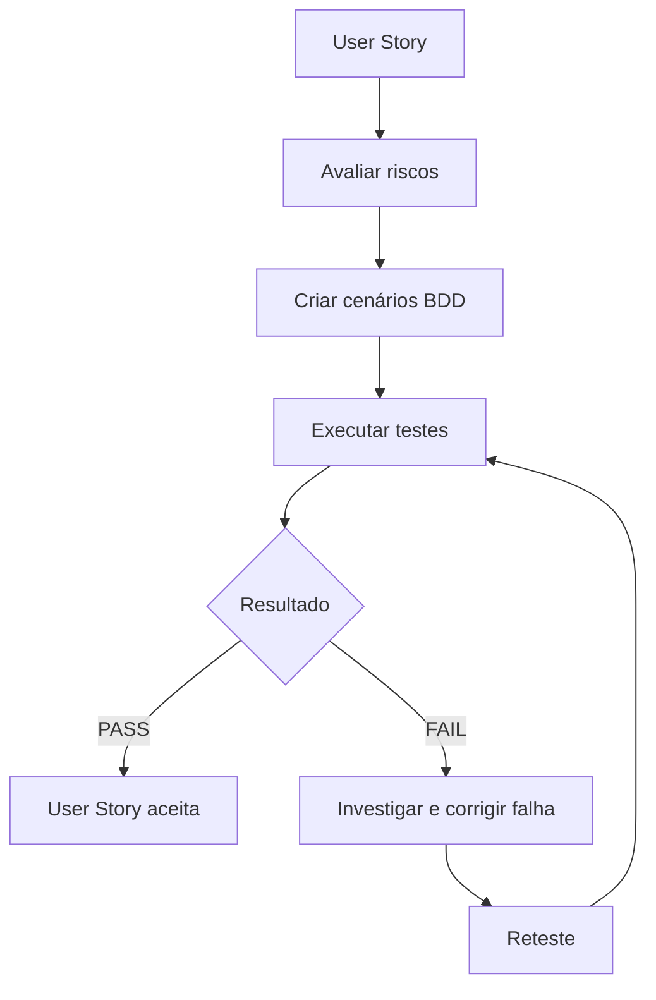

# Testes de Integração com BDD — Metodologia e Padrão de Implementação

---

## 1. O que é um teste de integração

Um teste de integração valida se **dois ou mais componentes reais do sistema funcionam corretamente quando conectados entre si** — ao contrário do teste unitário (que isola uma classe/método, normalmente com dependências mockadas).

No nosso projeto, isso normalmente significa: subir o contexto real da aplicação Spring, fazer uma chamada HTTP de verdade contra um controller (via MockMvc), deixar essa chamada atravessar o service, a camada de consulta (Specification/JPA Criteria) e chegar a um banco de dados real — e então verificar a resposta.

No frontend, os testes devem verificar se os componentes funcionam corretamente em conjunto, considerando suas interações, estados e comunicação com o backend.

| Tipo de teste | O que valida | Isolamento |
|---|---|---|
| **Integração** | A interação real entre componentes e camadas | Dependências reais ou equivalentes |

Um teste de integração não existe para provar que uma classe está certa isoladamente — existe para provar que a **fronteira entre componentes** funciona como esperado.

No backend, podemos validar a comunicação Controller → Service → Repository

No frontend, podemos validar a interação entre componentes, como filtros, gráficos, paginação e serviços responsáveis pela comunicação com a API.

Por isso, ao planejar um teste de integração, a primeira pergunta é sempre: **qual fronteira entre componentes estou validando aqui?**, não "qual classe estou testando?".

---

## 2. Metodologia BDD (Behavior-Driven Development)

### 2.1 O que é

BDD é uma forma de descrever o comportamento esperado de um sistema através de **exemplos concretos e observáveis externamente**, em vez de descrever como o código foi implementado por dentro.

O formato padrão para descrever esses exemplos é **Given / When / Then** (e o complemento `And`):

- **Given** — o estado do mundo antes da ação (quais dados existem, em que condição).
- **When** — a ação/evento que o comportamento descreve.
- **Then** — o resultado esperado, sempre **observável de fora** (resposta HTTP, corpo retornado ou comportamento apresentado na interface).
- **And** — complementa qualquer um dos três blocos anteriores quando há mais de uma condição, ação ou verificação no mesmo cenário.

Regra de ouro: se o `Then` só pode ser verificado abrindo o código-fonte (em vez de fazendo a chamada e observando o resultado), ele está descrevendo implementação, não comportamento.

Prefira sempre:

> "Then o sistema deve retornar os resultados relacionados ao termo pesquisado"

em vez de:

> "Then o SearchService deve chamar o Repository"

### 2.2 Exemplo aplicado

Pegando uma necessidade real da Sprint 1 (US02 — submeter descrição do caso para buscar conteúdo jurídico relacionado):

```text
Cenário: deve retornar jurisprudências cujo texto contém o termo pesquisado

Given: uma decisão judicial ativa com o termo "dano moral" no título/ementa,
       e outra decisão ativa sem esse termo

When: o usuário pesquisar pelo termo "dano moral"

Then: o sistema deve retornar apenas a decisão compatível
And: a resposta deve indicar a sigla da fonte de origem daquela decisão
```

Note que nada aqui fala de `Controller`, `Service`, `Specification` ou `Repository` — fala só do que o usuário pediu e do que ele deve receber de volta.

No frontend, a mesma metodologia pode descrever o comportamento de um componente:

```text
Cenário: aplicar filtro pelo gráfico

Given: o usuário está visualizando o dashboard

When: o usuário selecionar uma categoria no gráfico

Then: o sistema aplica o filtro correspondente
And: os indicadores são atualizados conforme a seleção
```

A tradução desses cenários para código será apresentada nas Seções 5 e 6.

### 2.3 BDD como critério de aceite

Este é o ponto mais importante deste documento: **os cenários BDD não são "só testes" — eles representam os critérios de aceitação de cada User Story.**

Isso muda a forma como uma User Story é considerada pronta:

- Uma US não está aceita só porque "o código compila" ou porque "parece funcionar manualmente".
- Uma US está aceita quando **todos os cenários BDD obrigatórios derivados dela passam**, de forma automatizada e repetível.
- Se durante a implementação surge um comportamento que não está coberto por nenhum cenário BDD já escrito, isso é sinal de que falta um cenário — não uma exceção que pode ser ignorada.

Na prática: o cenário BDD escrito na etapa de planejamento é o **contrato** entre "o que foi pedido" e "o que foi entregue". O teste automatizado é a forma como esse contrato é verificado a cada vez que o código muda.

---

## 3. Fluxo de testes de integração

O processo de validação de cada User Story seguirá cinco etapas. O fluxo é o mesmo para backend e frontend; o que muda é a ferramenta utilizada na implementação dos testes.



### Etapas do fluxo

**1. User Story**

Identificar a necessidade do usuário, a funcionalidade solicitada e os critérios de aceitação esperados.

**2. Avaliar riscos**

Identificar quais componentes, integrações e situações podem comprometer o comportamento esperado.

Exemplos:

- Falha na comunicação entre frontend e backend.
- Dados ausentes ou inválidos.
- Filtros retornando informações incorretas.
- Problemas na paginação.
- Componentes que não atualizam corretamente após uma interação.
- Falhas na consulta ou persistência de informações no banco de dados.

Os riscos identificados orientam quais cenários precisam ser criados e quais devem receber maior prioridade.

**3. Criar cenários BDD**

Transformar os riscos relevantes e os critérios de aceitação em exemplos concretos, utilizando Given, When e Then.

Os cenários devem representar comportamentos observáveis e contemplar situações de sucesso, falhas e condições alternativas relevantes.

**4. Executar testes**

Implementar e executar os testes automatizados correspondentes aos cenários BDD.

- Backend: utilizar JUnit 5, Spring Boot Test e MockMvc.
- Frontend: utilizar Playwright para automatizar os comportamentos no navegador.

**5. Resultado**

- **PASS:** todos os cenários obrigatórios passaram. A User Story pode ser considerada aceita.
- **FAIL:** investigar a falha, identificar a causa, corrigir o problema e executar novamente os testes (reteste).

A User Story somente será aceita quando todos os cenários obrigatórios definidos para ela apresentarem resultado satisfatório.

Se a investigação mostrar que o cenário ou o critério de aceitação está incorreto ou incompleto, ele deverá ser revisto com o time responsável antes de concluir a validação.

---

## 4. Cenários BDD já criados — Sprint 1

Os cenários abaixo foram derivados das 10 User Stories da Sprint 1.

> Cobertura completa (fronteiras de integração, matriz de testes, estratégia de Testcontainers/isolamento e lacunas) está no documento de planejamento da Sprint 1. Aqui ficam os cenários BDD como referência do que já foi especificado.

### US01 — Buscar jurisprudência, precedentes e doutrina relacionados ao caso

```text
Cenário: busca por termo retorna itens das três categorias

Given: existem uma decisão, um precedente e uma doutrina ativos,
       cada um contendo a palavra "dano" em campo pesquisável

When: o usuário pesquisar por "dano" nas três categorias

Then: cada categoria retorna o respectivo item na lista de resultados
```

### US02 — Submeter descrição do caso para iniciar a busca

```text
Cenário: termo válido retorna resultados compatíveis
Given: uma decisão ativa com o termo pesquisado
When: o usuário pesquisar por esse termo
Then: o sistema retorna a decisão compatível

Cenário: termo com múltiplas palavras casa por qualquer palavra relevante
Given: uma decisão contendo apenas uma das palavras da descrição do caso
When: o usuário pesquisar usando a descrição completa
Then: o sistema retorna essa decisão

Cenário: termo excede 300 caracteres
Given: um termo de pesquisa com 301 caracteres
When: o usuário realizar a busca
Then: o sistema responde HTTP 400

Cenário: termo ausente retorna todos os documentos ativos
Given: existem documentos ativos cadastrados
When: o usuário pesquisar sem informar nenhum termo
Then: o sistema retorna todos os documentos ativos, sem aplicar filtro de texto

Cenário: caracteres especiais de SQL LIKE não quebram a busca
Given: um termo de pesquisa contendo os caracteres "%", "_" e "\"
When: o usuário realizar a busca
Then: o sistema responde normalmente, sem erro e sem resultado incorreto
```

### US03 — Visualizar os resultados da busca

```text
Cenário: resultado traz os campos obrigatórios
Given: a busca retornou documentos correspondentes
When: o usuário visualizar a lista de resultados
Then: cada item contém, no mínimo, título e um resumo/ementa
And: a resposta indica o total de resultados e a paginação

Cenário: nenhum documento corresponde ao termo pesquisado
Given: não existe nenhum documento compatível com o termo
When: o usuário realizar a busca
Then: o sistema retorna lista vazia com total = 0, sem erro

Cenário: documento inativo não aparece nos resultados
Given: um documento marcado como indisponível e outro ativo, ambos com o mesmo termo
When: o usuário realizar a busca
Then: apenas o documento ativo aparece no resultado
```

### US04 — Visualizar a fonte de cada resultado

```text
Cenário: resultado exibe a sigla correta da fonte
Given: um documento importado de uma fonte conhecida (ex.: TJDFT)
When: o usuário visualizar o resultado
Then: o sistema retorna a sigla dessa fonte
```

### US05 — Acessar a fonte original de um resultado

```text
Cenário: documento com URL original preenchida
Given: um documento com a URL da fonte original preenchida
When: o usuário visualizar os detalhes do resultado
Then: o sistema retorna essa URL

Cenário: documento sem URL original (dado incompleto)
Given: um documento sem a URL da fonte original preenchida
When: o usuário visualizar os detalhes do resultado
Then: o sistema retorna o campo de URL como ausente/nulo, sem falhar a requisição
```

### US06 — Visualizar resultados do mais recente para o mais antigo

```text
Cenário: ordenação decrescente por data de julgamento
Given: existem decisões judiciais com datas de julgamento distintas
When: o usuário realizar uma busca
Then: os resultados vêm ordenados da data mais recente para a mais antiga

Cenário: decisão sem data de julgamento aparece por último
Given: existe uma decisão sem data de julgamento e outras com data
When: o usuário realizar uma busca
Then: a decisão sem data aparece depois de todas as que têm data
```

### US07 — Visualizar o número do processo, quando disponível

```text
Cenário: decisão com número de processo
Given: uma decisão judicial com número de processo preenchido
When: o usuário visualizar o resultado
Then: o sistema retorna esse número

Cenário: documento sem número de processo/tema (ex.: doutrina)
Given: um documento de doutrina, que não possui número de processo
When: o usuário visualizar o resultado
Then: o sistema retorna esse campo como nulo, sem falhar a requisição
```

### US08 — Identificar o tribunal ou órgão julgador responsável

```text
Cenário: decisão com tribunal e órgão julgador
Given: uma decisão judicial com tribunal e órgão julgador cadastrados
When: o usuário visualizar o resultado
Then: o sistema retorna a sigla do tribunal e o nome do órgão julgador

Cenário: documento sem vínculo com tribunal (doutrina)
Given: um documento de doutrina, que não possui tribunal
When: o usuário visualizar o resultado
Then: os campos de tribunal e órgão julgador vêm nulos, sem falhar a requisição
```

### US09 — Visualizar ementa/resumo de um resultado

```text
Cenário: documento com ementa/resumo preenchido
Given: um documento com ementa (decisão), questão jurídica (precedente)
       ou resumo (doutrina) preenchido
When: o usuário visualizar o resultado
Then: o sistema retorna esse texto no campo correspondente

Cenário: documento sem esse texto preenchido
Given: um documento sem ementa/resumo preenchido
When: o usuário visualizar o resultado
Then: o campo vem nulo, sem falhar a requisição
```

### US10 — Filtrar resultados por período, tribunal, fonte ou categoria

```text
Cenário: filtro por tribunal
Given: documentos de tribunais diferentes
When: o usuário filtrar por um tribunal específico
Then: apenas documentos daquele tribunal são retornados

Cenário: filtro por período
Given: documentos com datas de julgamento diferentes
When: o usuário filtrar por um intervalo de datas
Then: apenas documentos dentro do intervalo são retornados

Cenário: fonte ou tribunal inexistente
Given: o usuário informa uma sigla de fonte ou tribunal que não existe
When: a busca for executada
Then: o sistema responde HTTP 400

Cenário: período inválido (data inicial depois da data final)
Given: dataDe é posterior a dataAte
When: a busca for executada
Then: o sistema responde HTTP 400

Cenário: filtro válido sem nenhum resultado correspondente
Given: um filtro que não corresponde a nenhum documento existente
When: a busca for executada
Then: o sistema retorna lista vazia com total = 0, sem erro
```

---


### Teste de integração do frontend — Sprint 1

**Funcionalidade coberta:** submissão da descrição do caso e visualização dos resultados da pesquisa.

```text
Cenário: pesquisar um caso e visualizar os resultados retornados

Given: o usuário está na tela de pesquisa e informa uma descrição válida para o caso
And: o backend possui conteúdos jurídicos relacionados à descrição informada

When: o usuário executar a pesquisa

Then: a interface deve apresentar os resultados retornados pelo backend
And: cada resultado deve exibir seu título e resumo
And: o usuário deve conseguir identificar a fonte de cada resultado
```


## Cenários BDD — Sprint 2

### US11 — Visualizar dashboard com os indicadores da pesquisa

```text
Cenário: indicadores principais
Given: o usuário realizou uma pesquisa e possui resultados disponíveis
When: o usuário acessar o dashboard da pesquisa
Then: o sistema apresenta os indicadores de Aderência (%) e Total de Processos/decisões analisados

Cenário: distribuição do mérito
Given: os resultados possuem informações sobre o mérito das decisões
When: o usuário visualizar o dashboard
Then: o sistema apresenta um gráfico de rosca/pizza com a distribuição entre provido e desprovido, ou procedente e improcedente

Cenário: distribuição por Câmaras/Turmas
Given: os resultados possuem informações sobre a Câmara ou Turma responsável pelo julgamento
When: o usuário visualizar o dashboard
Then: o sistema apresenta um gráfico de barras com o volume e a distribuição dos resultados por Câmara/Turma

Cenário: evolução temporal
Given: existem resultados relacionados à tese pesquisada em diferentes períodos
When: o usuário visualizar o dashboard
Then: o sistema apresenta uma linha temporal com a evolução do entendimento sobre a tese ao longo do tempo

Cenário: dados referentes à pesquisa ativa
Given: o usuário realizou uma pesquisa ou possui um caso ativo
When: o usuário acessar o dashboard
Then: os indicadores e gráficos consideram apenas os resultados relacionados à pesquisa ou ao caso ativo
```

### US12 — Interagir com o dashboard para filtrar indicadores e resultados dinamicamente

```text
Cenário: aplicação de filtro pelo gráfico
Given: o usuário está visualizando o dashboard
When: o usuário selecionar um elemento de um gráfico, como uma Câmara/Turma ou uma categoria de mérito
Then: o sistema aplica o filtro correspondente aos dados apresentados

Cenário: atualização do dashboard
Given: o usuário aplicou um filtro por meio de um elemento do dashboard
When: o filtro for aplicado
Then: os indicadores e gráficos são atualizados de acordo com a seleção realizada

Cenário: atualização dos resultados
Given: existe um filtro ativo no dashboard
When: o usuário visualizar a lista de resultados
Then: o sistema apresenta apenas os processos correspondentes ao filtro selecionado

Cenário: remoção do filtro
Given: o usuário possui um ou mais filtros aplicados
When: o usuário remover os filtros
Then: o dashboard e a lista de resultados retornam à visualização completa da pesquisa
```

### US13 — Comparar os dados do caso com o panorama geral do tribunal

```text
Cenário: alternância de visualização
Given: o usuário está visualizando o dashboard da sua pesquisa
When: o usuário selecionar a opção de panorama geral do tribunal
Then: o sistema apresenta os dados gerais disponíveis do tribunal para comparação

Cenário: retorno à pesquisa atual
Given: o usuário está visualizando o panorama geral do tribunal
When: o usuário selecionar a visualização do seu caso/pesquisa
Then: o sistema volta a apresentar os indicadores relacionados à pesquisa ativa

Cenário: identificação do escopo
Given: o usuário alternou entre os dados da pesquisa e o panorama geral
When: os indicadores forem apresentados
Then: o sistema indica claramente qual conjunto de dados está sendo visualizado
```

### US14 — Encontrar conteúdos juridicamente semelhantes por interpretação do contexto do caso

```text
Cenário: interpretação semântica
Given: o usuário informou a descrição de um caso
When: o usuário realizar uma busca com auxílio da IA
Then: o sistema considera o significado e o contexto do caso, e não apenas correspondências exatas de palavras-chave

Cenário: elementos considerados
Given: a descrição do caso contém informações sobre fatos, fundamentos jurídicos e pedidos
When: a IA processar a pesquisa
Then: esses elementos são considerados na identificação dos conteúdos mais semelhantes

Cenário: recuperação de conteúdos semanticamente relacionados
Given: existem conteúdos juridicamente relacionados ao caso, mas escritos com termos diferentes
When: a busca semântica for realizada
Then: o sistema inclui esses conteúdos entre os resultados com base na similaridade de contexto
```

### US15 — Visualizar resultados ordenados por similaridade, com percentual e justificativa

```text
Cenário: ordenação por similaridade
Given: a busca por similaridade retornou múltiplos resultados
When: os resultados forem apresentados
Then: eles são ordenados do maior para o menor grau de similaridade com o caso pesquisado

Cenário: percentual de similaridade
Given: um resultado foi identificado pela busca semântica
When: o resultado for apresentado ao usuário
Then: o sistema exibe seu percentual de similaridade com o caso pesquisado

Cenário: justificativa da similaridade
Given: um resultado foi considerado semelhante ao caso pesquisado
When: o usuário visualizar esse resultado
Then: o sistema apresenta uma justificativa resumida, por meio de trecho ou tags, indicando os principais elementos responsáveis pela similaridade

Cenário: baixa aderência
Given: um resultado possui similaridade inferior a 50%
When: o resultado for apresentado na lista de resultados
Then: o sistema o mantém disponível e o identifica visualmente como resultado de baixa aderência
```

### US16 — Enviar documentos PDF ou DOCX relacionados ao caso

```text
Cenário: formatos aceitos
Given: o usuário deseja complementar as informações do seu caso
When: o usuário selecionar um arquivo nos formatos PDF ou DOCX
Then: o sistema permite o envio do documento

Cenário: formato não suportado
Given: o usuário selecionou um arquivo em formato diferente de PDF ou DOCX
When: o usuário tentar realizar o envio
Then: o sistema informa que o formato não é suportado e não processa o arquivo

Cenário: utilização do documento
Given: um documento válido foi enviado e processado
When: o usuário realizar a busca por similaridade
Then: as informações extraídas do documento podem ser utilizadas como contexto adicional da pesquisa
```

### US17 — Visualizar fatos e teses identificados pela IA nos documentos enviados

```text
Cenário: extração das informações
Given: o usuário enviou um documento válido
When: o documento for processado pela IA
Then: o sistema identifica e apresenta os principais fatos e teses encontrados no conteúdo

Cenário: visualização antes da pesquisa
Given: a IA concluiu a extração dos fatos e teses
When: o processamento do documento for finalizado
Then: o sistema apresenta ao usuário um resumo dos pontos identificados antes da execução da busca por similaridade

Cenário: utilização na busca
Given: fatos e teses foram identificados no documento
When: o usuário iniciar a busca por similaridade
Then: o sistema considera essas informações como contexto para a pesquisa
```

### US18 — Exportar em PDF os resultados e informações da pesquisa

```text
Cenário: geração do PDF
Given: o usuário possui uma pesquisa com resultados disponíveis
When: o usuário selecionar a opção de exportação
Then: o sistema gera um arquivo no formato PDF contendo as informações da pesquisa

Cenário: conteúdo exportado
Given: o usuário solicitou a exportação da pesquisa
When: o PDF for gerado
Then: o documento apresenta os principais dados da pesquisa e os resultados encontrados

Cenário: disponibilização do arquivo
Given: a geração do PDF foi concluída com sucesso
When: o processamento for finalizado
Then: o sistema disponibiliza o arquivo gerado ao usuário
```


### Teste de integração do frontend — Sprint 2

**Funcionalidade coberta:** interação com os elementos do dashboard.

```text
Cenário: filtrar os indicadores do dashboard por uma categoria do gráfico

Given: o usuário está visualizando o dashboard de uma pesquisa com resultados de diferentes categorias
When: o usuário selecionar uma categoria no gráfico

Then: a interface deve indicar que o filtro foi aplicado
And: os indicadores e a lista de resultados devem apresentar somente os dados correspondentes à seleção
And: ao remover o filtro, a visualização completa da pesquisa deve ser restaurada
```


## Cenários BDD — Sprint 3

Os cenários desta seção foram derivados das 10 User Stories informadas para a Sprint 3. Os testes de backend devem validar o comportamento integrado entre a API, os serviços responsáveis pelo processamento e as fontes de dados utilizadas. Quando houver integração com um serviço de IA, os resultados devem ser verificados por critérios observáveis e controlados, sem exigir que o texto gerado seja sempre idêntico.

### US19 — Receber análise do caso auxiliada por IA

```text
Cenário: gerar análise para um caso com descrição válida

Given: o usuário possui um caso cadastrado com descrição válida
And: o serviço de análise por IA está disponível

When: o usuário solicitar a análise do caso

Then: o sistema deve retornar uma análise associada ao caso informado
And: a resposta deve apresentar o conteúdo da análise em formato legível
And: o sistema deve indicar que a análise foi concluída

Cenário: solicitar análise sem descrição suficiente

Given: o usuário possui um caso sem informações mínimas para análise
When: o usuário solicitar a análise do caso

Then: o sistema deve informar que não há dados suficientes para realizar a análise
And: não deve apresentar uma análise como se tivesse sido concluída
```

### US20 — Considerar os resultados da pesquisa na análise realizada pela IA

```text
Cenário: análise considera os resultados jurídicos da pesquisa

Given: o usuário possui um caso com uma pesquisa concluída
And: a pesquisa possui resultados jurídicos relacionados ao caso

When: o usuário solicitar a análise auxiliada por IA

Then: a análise deve considerar as informações dos resultados da pesquisa
And: a resposta deve relacionar os pontos relevantes do caso aos conteúdos jurídicos encontrados

Cenário: análise sem resultados de pesquisa disponíveis

Given: o usuário possui um caso sem resultados de pesquisa associados
When: o usuário solicitar a análise auxiliada por IA

Then: o sistema deve informar que não há resultados de pesquisa disponíveis para fundamentar essa parte da análise
And: não deve apresentar referências a resultados inexistentes
```

### US21 — Identificar as informações e fontes utilizadas na análise gerada pela IA

```text
Cenário: apresentar as fontes utilizadas na análise

Given: existe uma análise gerada com base em resultados jurídicos recuperados pelo sistema
When: o usuário consultar os fundamentos da análise

Then: o sistema deve apresentar as fontes utilizadas
And: cada fonte deve permitir identificar o conteúdo jurídico correspondente
And: as informações apresentadas devem corresponder aos resultados efetivamente considerados na análise

Cenário: análise sem fontes recuperadas

Given: a análise foi gerada sem resultados jurídicos recuperados
When: o usuário consultar os fundamentos da análise

Then: o sistema deve informar que não foram utilizadas fontes de pesquisa
And: não deve inventar ou apresentar fontes não utilizadas
```

### US22 — Interagir com a análise gerada para obter esclarecimentos

```text
Cenário: enviar uma pergunta sobre a análise existente

Given: o usuário possui uma análise concluída para seu caso
When: o usuário enviar uma pergunta relacionada a um ponto específico da análise

Then: o sistema deve retornar uma resposta relacionada à pergunta
And: a resposta deve considerar o contexto da análise e do caso correspondente

Cenário: enviar uma pergunta sem análise associada

Given: o usuário não possui uma análise concluída para o caso
When: o usuário tentar enviar uma pergunta sobre a análise

Then: o sistema deve informar que não existe análise disponível para contextualizar a interação
```

### US23 — Acompanhar informações relevantes relacionadas ao caso

```text
Cenário: consultar informações acompanhadas de um caso

Given: o usuário possui informações relevantes salvas ou acompanhadas em seu caso
When: o usuário acessar a área de acompanhamento

Then: o sistema deve apresentar as informações associadas ao caso
And: cada informação deve manter sua identificação e origem, quando disponíveis

Cenário: caso sem informações acompanhadas

Given: o usuário possui um caso sem informações registradas para acompanhamento
When: o usuário acessar a área de acompanhamento

Then: o sistema deve apresentar uma indicação de que não existem informações acompanhadas
And: a consulta deve ser concluída sem erro
```

### US24 — Visualizar um dashboard aprimorado

```text
Cenário: apresentar indicadores do caso em uma visualização consolidada

Given: o usuário possui uma pesquisa com resultados disponíveis
When: o usuário acessar o dashboard do caso

Then: o sistema deve apresentar os indicadores e visualizações disponíveis para a pesquisa
And: os dados apresentados devem corresponder ao caso ou à pesquisa selecionada

Cenário: acessar dashboard sem dados disponíveis

Given: o usuário acessa um caso que ainda não possui resultados de pesquisa
When: o dashboard for carregado

Then: o sistema deve apresentar um estado vazio ou uma orientação para realizar uma pesquisa
And: a página deve permanecer utilizável, sem apresentar indicadores incorretos
```

### US25 — Melhorar as funcionalidades de pesquisa

```text
Cenário: realizar pesquisa utilizando os critérios disponíveis

Given: existem conteúdos jurídicos cadastrados e pesquisáveis
When: o usuário realizar uma pesquisa utilizando os critérios disponibilizados pelo sistema

Then: o sistema deve retornar os conteúdos compatíveis com os critérios informados
And: os resultados devem respeitar os critérios selecionados

Cenário: realizar pesquisa sem correspondências

Given: não existem conteúdos compatíveis com os critérios informados
When: o usuário executar a pesquisa

Then: o sistema deve retornar uma lista vazia
And: deve informar que nenhum resultado foi encontrado, sem apresentar erro inesperado
```

### US26 — Proteger a conta e as informações pessoais por meio de permissões de acesso

```text
Cenário: usuário autenticado acessa seus próprios dados

Given: o usuário está autenticado e possui dados associados à sua conta
When: o usuário solicitar acesso aos próprios dados

Then: o sistema deve permitir a consulta
And: deve retornar somente as informações às quais esse usuário tem permissão

Cenário: usuário tenta acessar dados de outra conta sem permissão

Given: existem dados associados a outro usuário
And: o usuário autenticado não possui permissão para acessá-los

When: o usuário tentar consultar esses dados

Then: o sistema deve negar o acesso
And: não deve expor informações pessoais da outra conta

Cenário: usuário não autenticado tenta acessar recurso protegido

Given: o usuário não possui uma sessão autenticada válida
When: o usuário solicitar acesso a um recurso protegido

Then: o sistema deve responder com status HTTP 401
And: não deve retornar os dados protegidos
```

### US27 — Limpar todos os filtros de pesquisa com uma única ação

```text
Cenário: remover todos os filtros aplicados

Given: o usuário realizou uma pesquisa e aplicou filtros de período, tribunal e categoria
When: o usuário solicitar a limpeza de todos os filtros

Then: o sistema deve remover os filtros aplicados
And: a pesquisa deve voltar a considerar os resultados sem essas restrições

Cenário: limpar filtros quando nenhum filtro está aplicado

Given: o usuário está visualizando os resultados sem filtros ativos
When: o usuário solicitar a limpeza dos filtros

Then: a interface deve permanecer no estado sem filtros
And: os resultados não devem ser alterados indevidamente
```

### US28 — Alternar entre os temas claro e escuro

```text
Cenário: ativar o tema escuro

Given: o usuário está utilizando a interface no tema claro
When: o usuário selecionar o tema escuro

Then: o sistema deve apresentar a interface no tema escuro
And: os elementos principais devem permanecer legíveis e disponíveis

Cenário: retornar ao tema claro

Given: o usuário está utilizando a interface no tema escuro
When: o usuário selecionar o tema claro

Then: o sistema deve apresentar a interface no tema claro
And: os elementos e funcionalidades da página devem continuar disponíveis
```

### Teste de integração do frontend — Sprint 3

**Funcionalidade coberta:** consulta da análise gerada por IA e visualização das fontes utilizadas.

```text
Cenário: consultar a análise do caso e verificar suas fontes na interface

Given: o usuário está autenticado e possui uma análise concluída para seu caso
And: a análise possui fontes jurídicas associadas

When: o usuário acessar a área de análise do caso

Then: a interface deve apresentar o conteúdo da análise
And: deve apresentar as fontes utilizadas como fundamento
And: o usuário deve conseguir identificar a qual conteúdo jurídico cada fonte corresponde
```


---

## 5. Implementação dos testes no backend

### 5.1 Frameworks utilizados

| Ferramenta | Papel |
|---|---|
| **JUnit 5** | Framework de teste (anotações `@Test`, `@BeforeEach`, `@DisplayName`) |
| **Spring Boot Test** (`@SpringBootTest`, `@AutoConfigureMockMvc`, `@Transactional`) | Sobe o contexto real da aplicação e faz o rollback automático dos dados de teste ao final de cada método |
| **MockMvc** | Simula requisições HTTP contra os controllers, sem precisar de um servidor HTTP de verdade |
| **H2** (modo PostgreSQL) | Banco em memória usado como infraestrutura de teste — mesma configuração já usada pelos testes existentes do projeto (`src/test/resources/application.properties`) |

> Essa é a stack atual, escolhida pela sua simplicidade — é exatamente o que o projeto já usa, sem nenhuma ferramenta nova. Uma evolução futura considerada seria trocar o H2 por um PostgreSQL real via **Testcontainers**, para validar contra o schema real do Flyway e o dialeto SQL real de produção. Essa troca fica registrada como possibilidade de evolução, não como pendência bloqueante.

### 5.2 Padrão de nomenclatura de arquivo

| Elemento | Convenção | Exemplo |
|---|---|---|
| Nome da classe | `[Componente]IntegrationTest` | `JurisprudenciaControllerIntegrationTest` |
| Nome do arquivo | Igual ao nome da classe + `.java` | `JurisprudenciaControllerIntegrationTest.java` |
| Nome do método de teste | Verbo no infinitivo/comportamento, em português, descrevendo o cenário | `deveRetornarJurisprudenciasCujoTextoContemOTermoPesquisado` |
| Anotação de apoio | `@DisplayName("...")` com a frase do cenário | `@DisplayName("deve retornar jurisprudências cujo texto contém o termo pesquisado")` |

O sufixo `IntegrationTest` existe para deixar explícito que aquele teste sobe o contexto Spring e valida a integração entre as camadas, diferente de um teste unitário simples.

### 5.3 Estrutura de pastas

Os testes de integração ficam junto dos demais testes JUnit, espelhando o pacote da classe testada em `src/main/java`:

```text
backend/
└── src/
    ├── main/
    │   └── java/forge/wikilaw/backend/
    │       ├── controller/
    │       ├── service/
    │       └── ...
    └── test/
        ├── java/forge/wikilaw/backend/
        │   ├── controller/
        │   │   └── JurisprudenciaControllerIntegrationTest.java
        │   ├── service/
        │   │   └── JurisprudenciaQueryServiceTest.java
        │   └── ...
        └── resources/
            └── application.properties
```

### 5.4 Exemplo real de implementação

Cenário implementado: **"deve retornar jurisprudências cujo texto contém o termo pesquisado"** (US02, caminho feliz), validando a fronteira Controller → Service → Specification → Repository → Banco.

Dois pontos de convenção:

- **Os dados de teste (`given:`) não são inseridos salvando a entidade diretamente pelo repository.** São inseridos através de `DocumentRecordProcessor.process(...)`, o mesmo componente usado pelo pipeline real de importação de documentos.
- **O `when:` sempre aciona a camada mais externa possível** — o controller, via `MockMvc` — nunca o service diretamente. É isso que garante que o teste valida a integração entre as camadas.

```java
package forge.wikilaw.backend.controller;

import static org.springframework.test.web.servlet.request.MockMvcRequestBuilders.get;
import static org.springframework.test.web.servlet.result.MockMvcResultMatchers.jsonPath;
import static org.springframework.test.web.servlet.result.MockMvcResultMatchers.status;

import forge.wikilaw.backend.entity.FonteDados;
import forge.wikilaw.backend.entity.RegistroBruto;
import forge.wikilaw.backend.entity.Tribunal;
import forge.wikilaw.backend.integration.documents.DocumentSource;
import forge.wikilaw.backend.integration.documents.NormalizedDocument;
import forge.wikilaw.backend.repository.FonteDadosRepository;
import forge.wikilaw.backend.repository.RegistroBrutoRepository;
import forge.wikilaw.backend.repository.TribunalRepository;
import forge.wikilaw.backend.service.DocumentRecordProcessor;
import java.time.LocalDate;
import java.time.OffsetDateTime;
import org.junit.jupiter.api.BeforeEach;
import org.junit.jupiter.api.DisplayName;
import org.junit.jupiter.api.Test;
import org.springframework.beans.factory.annotation.Autowired;
import org.springframework.boot.test.context.SpringBootTest;
import org.springframework.boot.webmvc.test.autoconfigure.AutoConfigureMockMvc;
import org.springframework.test.web.servlet.MockMvc;
import org.springframework.transaction.annotation.Transactional;

@SpringBootTest
@AutoConfigureMockMvc(addFilters = false)
@Transactional
class JurisprudenciaControllerIntegrationTest {

    @Autowired private MockMvc mockMvc;
    @Autowired private DocumentRecordProcessor processor;
    @Autowired private FonteDadosRepository fontes;
    @Autowired private TribunalRepository tribunais;
    @Autowired private RegistroBrutoRepository registrosBrutos;

    private FonteDados fonte;
    private RegistroBruto registroBruto;

    @BeforeEach
    void prepararDados() {
        fonte = new FonteDados();
        fonte.setNome("Jurisprudência TJDFT");
        fonte.setSigla("TJDFT");
        fonte.setTipoFonte("JURISPRUDENCIA");
        fonte = fontes.saveAndFlush(fonte);

        Tribunal tribunal = new Tribunal();
        tribunal.setSigla("TJDFT");
        tribunal.setNome("Tribunal de Justiça do Distrito Federal e dos Territórios");
        tribunal.setUf("DF");
        tribunais.saveAndFlush(tribunal);

        registroBruto = new RegistroBruto();
        registroBruto.setFonte(fonte);
        registroBruto.setFormatoPayload("JSON");
        registroBruto.setDataColeta(OffsetDateTime.now());
        registroBruto.setHashConteudo("hash-ficticio-de-teste");
        registroBruto.setPayloadTexto("{}");
        registroBruto = registrosBrutos.saveAndFlush(registroBruto);
    }

    @Test
    @DisplayName("deve retornar jurisprudências cujo texto contém o termo pesquisado")
    void deveRetornarJurisprudenciasCujoTextoContemOTermoPesquisado() throws Exception {
        // given: uma decisão judicial ativa com o termo no título/ementa e outra sem o termo
        salvarDecisao(
                "decisao-relevante",
                "Decisão sobre dano moral por inadimplemento contratual",
                "O dano moral resta configurado quando há violação a direito da personalidade.",
                "0001234-56.2023.8.07.0001",
                LocalDate.of(2025, 5, 10));

        salvarDecisao(
                "decisao-irrelevante",
                "Decisão sobre revisão de cláusula de reajuste contratual",
                "Discute-se a legalidade da correção monetária aplicada ao contrato.",
                "0009876-54.2023.8.07.0002",
                LocalDate.of(2025, 3, 1));

        // when: o usuário pesquisar por esse termo
        var resultado = mockMvc.perform(get("/api/jurisprudencias").param("termo", "dano moral"));

        // then: o sistema deve retornar apenas a decisão compatível
        resultado.andExpect(status().isOk())
                .andExpect(jsonPath("$.total").value(1))
                .andExpect(jsonPath("$.itens.length()").value(1))
                .andExpect(jsonPath("$.itens[0].titulo")
                        .value("Decisão sobre dano moral por inadimplemento contratual"))
                .andExpect(jsonPath("$.itens[0].numeroProcesso").value("0001234-56.2023.8.07.0001"))
                // and: a resposta deve indicar a sigla da fonte de origem
                .andExpect(jsonPath("$.itens[0].fonte").value("TJDFT"));
    }

    private void salvarDecisao(
            String identificador, String titulo, String ementa, String numeroProcesso, LocalDate dataJulgamento) {
        var decisao = NormalizedDocument.builder()
                .identificador(identificador)
                .titulo(titulo)
                .tipo("Acórdão")
                .resumo(ementa)
                .decisao("Recurso conhecido.")
                .numeroProcesso(numeroProcesso)
                .relator("Desembargador Exemplo")
                .orgaoJulgador("2ª Turma Cível")
                .dataJulgamento(dataJulgamento)
                .dataPublicacao(dataJulgamento.plusDays(5))
                .url("https://example.test/decisoes/" + identificador)
                .metadados("{}")
                .build();
        processor.process(DocumentSource.TJDFT, fonte.getId(), registroBruto.getId(), decisao);
    }
}
```

Repare como cada parte do código mapeia diretamente para o cenário BDD descrito na Seção 2.2 — isso não é coincidência, é o objetivo: **ler o teste deveria ser equivalente a ler a especificação**, sem precisar de tradução mental entre os dois.

---

## 6. Implementação dos testes no frontend

### 6.1 Unidades de referência e estratégia de testes

No frontend, os **componentes são as unidades funcionais de referência** para organizar e planejar os testes.

Um componente pode representar, por exemplo:

- Um filtro de pesquisa;
- Um gráfico;
- Uma tabela de resultados;
- Um componente de paginação;
- Uma área do dashboard;
- Um botão de exportação.

Os testes devem verificar os comportamentos observáveis desses componentes e, quando necessário, a interação entre eles e a comunicação com o backend.

É importante diferenciar os níveis de teste:

| Tipo de teste | O que valida | Estratégia/ferramenta |
|---|---|---|
| **Integração do frontend** | A interação entre componentes, estados, serviços e respostas da API | Playwright no navegador |

O Playwright é recomendado para automatizar os cenários de integração do frontend porque executa interações em navegadores reais e permite verificar o resultado apresentado ao usuário.

Entretanto, nem todo teste escrito com Playwright deve ser classificado automaticamente como teste de integração: a classificação depende do escopo e das fronteiras efetivamente validadas.

### 6.2 Ferramentas utilizadas

| Ferramenta | Papel |
|---|---|
| **Playwright** | Automatizar interações no navegador e validar o comportamento da aplicação. |
| **Playwright Test** | Organizar, configurar e executar os testes automatizados. |
| **TypeScript** | Linguagem utilizada na implementação dos arquivos de teste. |
| **Playwright Assertions** | Verificar resultados esperados, como elementos visíveis, textos, estados e respostas. |
| **Playwright Fixtures** | Preparar e compartilhar recursos necessários para a execução dos testes. |

Com Playwright, é possível:

- Simular cliques, preenchimento de campos e seleções;
- Verificar se os componentes apresentam os dados corretamente;
- Validar filtros, paginação e interações entre gráficos;
- Verificar a navegação entre páginas;
- Validar a comunicação entre frontend e backend;
- Registrar evidências e relatórios quando um cenário falhar.

### 6.3 Estrutura de pastas

Os testes do frontend devem ficar no diretório `frontend/tests`, separados do código-fonte da aplicação.

A estrutura atualmente utilizada no projeto pode ser mantida:

```text
frontend/
├── public/
├── src/
└── tests/
    ├── helpers/
    │   └── test-helper.ts
    ├── chart-filters.spec.ts
    ├── dashboard-scope.spec.ts
    ├── dashboard.spec.ts
    ├── export-pdf.spec.ts
    ├── hero-filters.spec.ts
    ├── home-scroll.spec.ts
    └── pagination.spec.ts
```

Responsabilidades:

- **`tests/`:** concentra os testes automatizados do frontend.
- **`tests/helpers/`:** armazena funções auxiliares reutilizáveis, como procedimentos comuns de preparação e navegação.
- **`*.spec.ts`:** contém os cenários automatizados de uma funcionalidade ou comportamento.


### 6.4 Implementação dos cenários BDD com Playwright

A implementação deve manter correspondência com os cenários BDD definidos para a User Story.

Cada etapa do cenário deve ser traduzida em preparação, ação e verificação observável.

**Cenário BDD: aplicação de filtro no dashboard**

```text
Cenário: aplicação de filtro pelo gráfico

Given: o usuário está visualizando o dashboard

When: o usuário selecionar uma categoria no gráfico

Then: o sistema aplica o filtro correspondente

And: os indicadores são atualizados conforme a seleção
```

**Exemplo de implementação com Playwright:**

```typescript
import { test, expect } from '@playwright/test';

test.describe('Filtros do dashboard', () => {

  test('deve aplicar filtro ao selecionar uma categoria no gráfico', async ({ page }) => {

    // Given: o usuário está visualizando o dashboard
    await page.goto('/dashboard');

    await expect(
      page.getByTestId('dashboard')
    ).toBeVisible();

    // When: o usuário seleciona uma categoria
    await page.getByTestId('chart-category-provido').click();

    // Then: o filtro correspondente deve ser aplicado
    await expect(
      page.getByTestId('active-filters')
    ).toContainText('Provido');

    // And: os indicadores devem apresentar os dados filtrados
    await expect(
      page.getByTestId('dashboard-indicators')
    ).toBeVisible();

  });

});
```

Este exemplo é ilustrativo. A rota e os identificadores `data-testid` devem corresponder aos elementos realmente implementados no WikiLaw.

A verificação de visibilidade dos indicadores, por si só, não comprova que os valores foram recalculados. Para isso, o cenário deve verificar também os valores esperados após a aplicação do filtro.

Correspondência entre BDD e código:

| Etapa BDD | Implementação |
|---|---|
| **Given** | Preparar o estado inicial e acessar a funcionalidade. |
| **When** | Executar a interação do usuário. |
| **Then** | Verificar o resultado principal esperado. |
| **And** | Verificar resultados complementares. |

O teste deve validar o resultado apresentado ao usuário, evitando depender de detalhes internos como nomes de funções, variáveis de estado ou a estrutura interna dos componentes.

### 6.5 Responsabilidade dos helpers

O arquivo `tests/helpers/test-helper.ts` deve concentrar procedimentos reutilizáveis entre diferentes cenários, como:

- Preparação de condições iniciais comuns;
- Procedimentos de autenticação, quando necessários;
- Funções auxiliares de navegação;
- Operações repetitivas de interação com a aplicação;
- Apoio à preparação de dados de teste.

Os helpers não devem concentrar todos os cenários nem esconder as ações principais do teste.

A leitura do arquivo `.spec.ts` deve continuar permitindo entender o Given, When e Then do cenário.

### 6.6 Boas práticas de implementação

1. **Priorizar o comportamento:** validar aquilo que o usuário consegue observar e realizar.
2. **Evitar dependência entre testes:** um cenário não deve depender da execução anterior.
3. **Reutilizar helpers:** reduzir duplicação sem esconder a intenção dos cenários.
4. **Utilizar seletores estáveis:** priorizar locators acessíveis, como roles e labels; utilizar `data-testid` quando necessário.
5. **Preparar os dados:** cada cenário deve possuir condições iniciais conhecidas e reproduzíveis.
6. **Evitar esperas fixas:** utilizar as verificações e esperas automáticas do Playwright em vez de atrasos arbitrários.
7. **Preservar a independência:** os testes devem funcionar individualmente e em conjunto.
8. **Registrar falhas:** utilizar relatórios, screenshots e traces para facilitar a investigação.
9. **Validar a integração real quando esse for o objetivo:** não substituir indiscriminadamente a API por mocks. Simulações podem ser úteis para cenários específicos de erro ou indisponibilidade, mas devem ser identificadas como tal.

---
